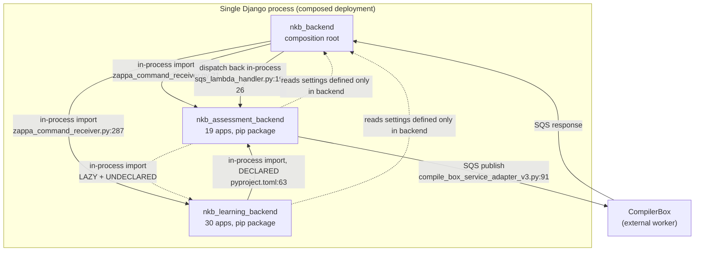

# Cross-Repository Dependencies

**Read this before asserting that one repository calls another.** The intuition that
three backend repositories means three services talking over HTTP is wrong here, and
several naming coincidences actively reinforce the wrong answer.

## The dependency graph

Solid lines are confirmed by reading both the calling and receiving code. Dotted lines
are confirmed but represent implicit or lazy coupling.

## Confirmed edges

### 1. `nkb_backend` → both libraries (in-process)

The composition root calls into both siblings as ordinary Python.

- `nkb_backend/zappa_command_receiver.py:21` —
  `from nkb_exam.interfaces.service_interface import ServiceInterface`
- `nkb_backend/zappa_command_receiver.py:287` —
  `from nkb_resources.interfaces.service_interface import ServiceInterface`

Receiving side: `nkb_assessment_backend/nkb_exam/interfaces/service_interface.py:197-208`.

### 2. `nkb_learning_backend` → `nkb_assessment_backend` (in-process, declared)

The densest edge in the system. Roughly twenty adapter classes in learning wrap
assessment `ServiceInterface`s.

- Declared: `nkb_learning_backend/pyproject.toml:63` —
  `nkb_assessment_backend >=5.0.0,<6.0.0`
- Called: `nkb_learning_backend/nkb_niat/adapters/assessment_service_adapter.py:15`,
  `nkb_learning_backend/nkb_resources/utils/get_content_data_util.py:42-48`

One adapter bypasses the published interface entirely and imports the assessment app's
storage layer directly — a layering violation that crosses a repository boundary:
`nkb_niat/adapters/assessment_service_adapter.py:55-64` imports
`nkb_assessment.storages.storage_implementation.AssessmentStorageImplementation`.

### 3. `nkb_assessment_backend` → `nkb_learning_backend` (in-process, lazy, **undeclared**)

This edge closes the cycle and is the most fragile thing in the graph.

- `nkb_coding_practice/adapters/coding_core_service_adapter.py:75`
- `nkb_exam/adapters/learning_resource_service_adapter.py:19`
- `nkb_question/adapters/learning_path_service/learning_path_service_adapter.py:7`

None of these targets appear in `nkb_assessment_backend/pyproject.toml`. The imports
are deferred inside `@property` and method bodies, so the package imports cleanly on
its own — the build-time graph stays acyclic while the **runtime graph is cyclic**. A
missing sibling produces a call-time `ImportError`, not an install-time failure.

### 4. Both libraries → `nkb_backend` (configuration ownership inversion)

The libraries read Django settings that only the host defines.

- `nkb_assessment_backend/nkb_question/adapters/compile_box_service_adapter_v3.py:162`
  reads `settings.SQS_COMPILER_BOX_QUEUE_BASE_URL`, defined only at
  `nkb_backend/nkb_backend/settings/base.py:627-628`.
- `nkb_learning_backend/nkb_auth_v2/sub_handlers/poster_generated_sub_handler.py:13`
  reads `settings.IB_EVENTS_POSTER_GENERATED_SUBSCRIPTION`, defined only at
  `nkb_backend/nkb_backend/settings/base_server.py:121`.

These code paths cannot run correctly outside the composed deployment.

`nkb_learning_backend` also imports `nkb_backend` internals directly, with no fallback:
`nkb_learning_path/adapters/nkb_core_service/nkb_core_service.py:20` and
`nkb_projects/utils/evaluation_submission_with_ai.py:45`.

### 5. The one asynchronous edge: CompilerBox over SQS

This is the only cross-repository interaction that crosses a process boundary.

1. `nkb_assessment_backend/nkb_question/adapters/compile_box_service_adapter_v3.py:91-94`
   publishes an evaluation request to a per-language SQS queue.
2. An external CompilerBox worker consumes it, evaluates the code, and publishes a
   response.
3. `nkb_backend/sqs_lambda_handler.py:19-26` — wired at
   `nkb_backend/zappa_settings.json:162` — consumes the response and dispatches it
   back into assessment receivers, in-process.

Queue names live only in `nkb_backend`:
- Request: `CompilerBox-code-evaluation-request-{production,dev}-Queue-<lang>`
  (`nkb_backend/nkb_backend/settings/ccbp_prod.py:449`)
- Response: `CompilerBox-code-evaluation-response-{production,dev}-Queue`
  (`ccbp_prod.py:650`)

Note the asymmetry: **assessment publishes, but backend consumes.** The library cannot
receive its own results; it depends on the host's Lambda wiring to close the loop.

## Possible, not confirmed

**Certificate poster generation via ib_events.** `nkb_certificate` emits
`GENERATE_CERTIFICATE` (`nkb_certificate/adapters/ib_events_service_adapter.py:47-51`)
and all three repos subscribe to `POSTER_GENERATED`. But the producer of
`POSTER_GENERATED` is an external rendering service that is not in any of these repos.
The three are **co-subscribers to a third party**, not producer and consumer of each
other. Confidence: MEDIUM.

**Shared database.** All three read identical `RDS_*` env var names and there is no
per-app DB routing. In the composed deployment a single shared database is certain.
Whether the *legacy standalone* deployments point at the same RDS instance is UNKNOWN
— the values are deploy-time secrets.

## Claims that were investigated and rejected

These are the traps. Each was checked and found false.

### "The `get_service_adapter` / `interfaces/service_interface.py` pattern is cross-service RPC."

**No.** It is in-process. `ServiceInterface` methods are plain `@staticmethod`s that
directly instantiate the target app's `StorageImplementation` and interactor in the
same Python process and return the result. There is no serialization, no transport, no
base URL, no client, no timeout.

See `nkb_assessment_backend/nkb_exam/interfaces/service_interface.py:197-208`.

The adapter layer exists to preserve clean-architecture boundaries *between Django
apps*. It is an architectural boundary, not a topological one. These calls genuinely
are cross-repository — but they are not cross-process, and describing them as service
calls will lead to wrong conclusions about latency, failure modes, and deployability.

### "`TOPIN_BASE_URL` is an HTTP edge to `nkb_assessment_backend`."

**No.** TOPIN is an unrelated external assessment product (topin.tech). Its configured
path prefix `/api/nw_integrations` has **zero** matches anywhere in
`nkb_assessment_backend`, whose own hostnames are `nkb-assessment-backend-*.apigateway.in`.

TOPIN is consumed only by `nkb_learning_backend/nkb_placement_support/adapters/topin_adapter.py:53`.

### "There is a REST/HTTP edge between any two of the three repos."

**No.** No repo constructs a URL targeting another. Searching for `/api/nkb_[a-z_]+/`
across all three returns only each repo's own `basePath` values and its own view tests.
Every `requests.*` call site targets an external system — Azure OpenAI, Google Speech,
BigQuery, CompilerBox, Codeforces, TOPIN, Woolf.

There is no `NKB_BACKEND_URL`, no `ASSESSMENT_SERVICE_URL`, no equivalent setting.

### "`nkb_leaderboard` links assessment to learning."

**No.** `nkb_leaderboard` is owned solely by `nkb_assessment_backend`
(`settings/base_swagger_utils.py:27`). The similarly-named `ib_leaderboard`,
`nw_leaderboard`, and `nw_activities` are separate external pip packages, outside all
three repositories.

### "`IB_EVENTS_*` subscriptions are events exchanged between these three repos."

**No.** The subscription constants are named after *external* producers — payments and
NACH, `ib_user_accounts`, TOPIN, job readiness, poster generation. No subscription name
in one repo matches an `emit_event` event type in a sibling.
See `nkb_backend/nkb_backend/settings/base_server.py:109-158`.

### "`mark_unit_as_completed_handler` consumes assessment results."

**No.** Despite the name,
`nkb_learning_backend/nkb_resources_extensions/sub_handlers/mark_unit_as_completed_handler.py:14`
registers on `IB_EVENTS_UPDATE_USER_AI_INTERVIEW_STATUS_SUBSCRIPTION` — an AI-interview
subscription, not an assessment one.

## Shared identifiers

`user_id` is shared across all three but originates in the external `ib_users` package.
Shared vocabulary is not by itself a dependency.

More consequentially: `exam_id`, `assessment_id`, and `question_set_id` form **one
identifier space with no translation layer**.
`nkb_learning_backend/nkb_resources/utils/get_content_data_util.py:41-84` passes a
learning `unit_id` straight through as an assessment `exam_id`. Any change to
identifier semantics on either side is a silent cross-repo break.
